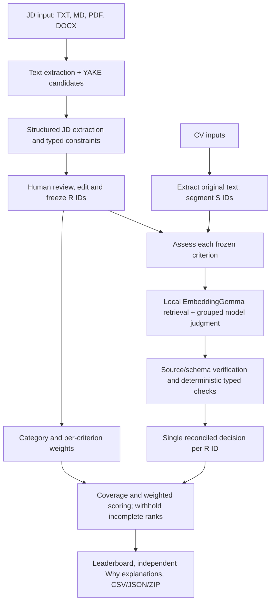

# CV Ranker — Unified architecture and operating contracts

**Current reference:** Supervisor Edition · Phase 7G · UI 4.9.42 · 10 November 2026  
**Assessment identity:** `phase7g-v4-9-39-individual-criterion-why-restored-2026-11-10`  
**Protocol:** `segment_ids_semantic_llm` version 31  
**Scope:** implemented source behavior, not a promise of independent hiring accuracy.

This is the **canonical technical reference** for the current checkout. Prior phase reports, implementation plans, release notes and historical benchmarks under `docs/` and `evaluation/results/` are preserved for chronology, not used as current behavioral specifications. See [repository audit](REPOSITORY_AUDIT.md) for staged cleanup actions and [README](../README.md) for quick start.

## 1. Product boundaries

The application compares one job description (JD) with multiple CVs and shows *what each CV claims*, where the claim appears, and how the approved requirements affect a ranked comparison. This is an **AI-assisted screening and human-review tool**. It does not verify employment, degrees, licenses, work eligibility, identity or real-world skill, and must not make an unattended hiring decision.

- Front ends: local Streamlit UI (`app.py`) and command-line interface (`main.py`). **There is no separately exposed HTTP/REST API.**
- Providers: local Ollama or cloud OpenRouter for structured assessment. **Both current AI-assisted unified assessment modes require a reachable local Ollama EmbeddingGemma model for evidence retrieval.** Offline fallback can run without a model.
- Storage: original uploads are processed in temporary directories during UI runs; retained parsed source ledgers and assessment checkpoints are held in Streamlit session state. Local SQLite embedding cache is an optimization. No application database, user login or centralized applicant repository is implemented.
- Core principle: no profession- or candidate-specific skill answer keys. Frozen JD requirements, original CV segments, general evidence checks and source-backed model judgments are the contracts.

## 2. Data flow and trust boundaries



**Important distinctions:**

1. YAKE discovers phrase candidates; it does not create scoring criteria by itself. JD extraction and source validation happen before approval.
2. JD criteria have stable `R001`-style IDs. A reviewer may edit and approve them, but assessment cannot silently change the frozen denominator or claim sources.
3. Each CV becomes original `S001`-style evidence segments with section metadata. Embeddings prioritize **retrieval leads**, not proof or direct points; literal/typed source recall augments retrieval when needed.
4. The unified model returns structured, cited judgments. Pydantic and Python validators check source IDs, proof excerpts, matched terms, scoped experience duration, degree claims, negation, compound constraints and related conditions. A source-consistent assertion can still be semantically mistaken; human review remains necessary.
5. `Found` is the only directly credited state. `Transferable` indicates related evidence but earns **zero** match points. `Not Found` means the submitted CV did not establish the specific requirement. `Unverified` is a technical/incomplete state, **not** a candidate nonmatch.
6. Ranking explanations in `ranking_reasoning.py` derive from finalized decisions and score contributions **without an additional model call**. Their `structurally_valid` check establishes internal/source consistency, not factual truth of free-text prose.

### Main execution modes

| Mode | Primary path | Consequences |
|---|---|---|
| AI-assisted supervisor UI | `app.py` → `cv_ranker/ui/dashboard.py` → `CVRanker(..., unified=True)` → `UnifiedEvidenceEngine` | Frozen JD approval; local embeddings; grouped selected-provider judgments; final source/typed checks; current weighted leaderboard. |
| Offline UI fallback | `dashboard.py` → `CVRanker(..., use_llm=False)` → `ui/final_decisions.py` | Explicit conservative behavior; no cloud calls; review labels must not be confused with independently verified skill. |
| CLI | `main.py` → `CVRanker.run` → `report.write_json` | Legacy/base coverage and JSON output. CLI does not expose the full interactive weighted supervisor projection. |
| Optional semantic diagnostics / older shadow demos | `cv_ranker/semantic/*`, `ui/semantic_workflow.py`, `scripts/phase7g_*.py` | Historical/research interfaces; documented as read-only proposals. Do **not** assume they are a second live scoring pass in the current UI. |

## 3. Core module ownership

| Layer | Implementations | Responsibility |
|---|---|---|
| Configuration/release | `config.py`, `build_info.py`, `runtime_check.py`, `build_manifest.json` | Selected provider and model settings; immutable assessment identity; source SHA-256 checks. |
| Document ingestion | `documents.py`, `segments.py` | Supported file formats; DOCX paragraph/table order; original source IDs. Image-only scans need OCR externally. |
| JD preparation | `yake_extractor.py`, `jd.py`, `requirement_typing.py`, `jd_review.py`, `constraints.py`, `criteria_scope.py` | Candidate keywords, sourced JD extraction, criterion typing and explicit reviewer approval. |
| Structured inference | `llm.py`, `assessor.py`, `unified.py` | Ollama/OpenRouter adapter, structured replies, source retrieval planning, grouped per-CV assessment and error accounting. |
| Embedding/search | `semantic/embedding.py`, `semantic/core.py`, `semantic/cache.py`, `semantic/adapters.py`, `semantic/integration.py` | Local vector representation, cached search, original-segment retrieval and separate shadow diagnostics. |
| Evidence/typed checks | `text_utils.py`, `evidence_bridge.py`, `experience_validation.py`, `qualification_validation.py`, `compound_validation.py`, `alias_approvals.py`, `eligibility.py` | Generic evidence checks and optional JD-specific reviewer-supplied policies. No credential authentication. |
| Orchestration | `pipeline.py`, `resume.py` | Candidate loop, saved checkpoint reuse, existing judgments and build/JD/policy identity checks. |
| Scores and explanations | `scoring.py`, `weighted_scoring.py`, `ranking_reasoning.py` | Base coverage contract, supervisor weights and deterministic ranking narratives. |
| UI and exports | `ui/dashboard.py`, `ui/unified_decisions.py`, `ui/final_decisions.py`, `ui/evidence_inspection.py`, `ui_support.py`, `report_bundle.py`, `report.py` | Supervisor pages, single final criterion table, source display and sensitive export serialization. |
| Verification | `tests/`, `evaluation/`, `doctor.py`, `scripts/rebuild_manifest.py` | Offline regressions, synthetic benchmarks, local health and distributable integrity. |

**Why some names overlap:** `scoring.py` defines the base `CandidateResult` coverage/rank contract; `weighted_scoring.py` is the editable supervisor projection. Likewise `ui/unified_decisions.py` projects the current LLM result, while `ui/final_decisions.py` supports offline/legacy focused reconciliation. These are both **active**, not safe duplicate files to delete.

## 4. Data contracts and invariants

The primary Python contracts are strict Pydantic models in `cv_ranker/schemas.py` (`extra=forbid`, `strict=True`). Serializations use `.model_dump()` and `.model_validate()`; this section summarizes notable fields rather than reproducing every nested schema.

| Object | Key fields | Invariant |
|---|---|---|
| `JDReviewDraft` | `jd_sha256`, `requirements`, `yake_candidates`, `approved`, `edited`, `diagnostics` | Assessment from the UI requires explicit approval, unique frozen requirement IDs and unchanged JD source hash. |
| `ValidatedRequirement` | `requirement_id`, `name`, `priority`, `jd_evidence`, `constraint` | Each requirement refers to actual source JD text; categories may be skill, experience, education, credential, etc. |
| `RequirementConstraint` | `kind`, `minimum_years`, `experience_mode`, `degree_level`, `field_of_study`, `operator`, `options` | Numeric minimum applies only to experience; invalid combinations reject before scoring. |
| `LLMAssessmentItem` | `requirement_id`, `status`, `evidence_ids`, `matched_term`, `reason` | Model proposals must map to approved requirement IDs and cited original source IDs; proposals alone never establish direct credit. |
| `RequirementAssessment` | `status`, `unified_status`, `assessment_state`, `evidence_segments`, `reason`, typed check objects | Only source-validated, verified `matched`/`Found` can earn points. Technical uncertainty is retained as `unverified`. |
| `CandidateResult` | `candidate_name`, `assessments`, `primary_score`, `rank`, required/preferred counts, `errors` | Missing/duplicate requirement coverage is invalid. Any unverified criterion withholds overall score/rank, preserving valid individual rows. |
| `RankingReport` | `build_id`, `jd_sha256`, `requirements`, `candidates`, JD diagnostics, policy hashes, original JD | The approved denominator and build identity are stable across the run and resume. |
| Supervisor final result (dictionary) | `Candidate`, `Criteria[]`, `Found`/`Transferable`/`Not Found` decisions, `Why`, `Checkpoints`, counts, `Notices`, legacy `Provisional` | One final requirement row per frozen ID, with exact original segment text and independent **Why this decision**; `Provisional` is not the UI's completion flag. |

### Entry-point contracts (no REST API)

```python
from pathlib import Path
from cv_ranker import CVRanker, Settings

ranker = CVRanker(settings=Settings(), use_llm=False)
draft = ranker.prepare_jd_review(Path("sample_data/backend_jd.txt"))
report = ranker.run(
    Path("sample_data/backend_jd.txt"),
    [Path("sample_data/backend_resumes/01_strong.txt")],
)
# For the interactive supervisor flow, approve the JD before ranker.run(..., approved_jd=draft).
```

- `CVRanker.prepare_jd_review(jd_path) -> JDReviewDraft`: loads one JD, obtains YAKE candidates, returns typed and sourced requirements. Draft is **not automatically approved**.
- `cv_ranker.jd_review.approve_jd_rows(...)`: reviewer-side approval and edits; use the exact function signature from code when integrating.
- `CVRanker.run(jd_path, resume_paths, *, approved_jd=None, resume_report=None, resume_candidates=None) -> RankingReport`: operates on multiple resume files. The UI always supplies the approved draft; the CLI's compatibility path allows implicit JD preparation.
- `ScoreWeights(experience=10, education=10, jd=80, requirement_shares=...)` and `weighted_leaderboard(report, weights)`: call-free supervisor scoring over existing decisions. See section 5 for allocation semantics.
- `complete_results_zip(report, weights, final_results=..., source_ledgers=..., technical=...) -> bytes`: builds reviewer export **from existing state**, no model replay.

### Source validation and incomplete assessments

The score boundary requires **exactly one** assessment per frozen requirement. An AI response with missing/duplicate IDs, unsourced quoted text or a mismatched `matched_term` is subject to bounded correction and explicit failure states. Repeated identical invalid requests are paused to protect cloud quota. If any requirement remains technically unverified, the candidate's percentage/rank is **withheld**; accepted per-criterion judgments and retrieval leads remain available for human inspection. Never convert an invalid model response to `Not Found` merely to complete a leaderboard.

## 5. Scoring and explaining a rank

Supervisor weights default to 10% Experience, 10% Education, 80% JD and must sum to 100. The JD category contains **all Required and Preferred requirements in one pool** (except criteria separately bucketed to numeric experience and education); the **split** toggle affects presentation only. Each requirement owns a configurable share of its category; the category's shares sum to 100%, and changing one share proportionally rebalances its peers.

For criterion `i` in category `c`, the possible points are:

`possible_i = effective_category_weight_c × category_share_i / 100`

Its earned points equal `possible_i` **only** for a verified `Found`; otherwise zero. If an approved JD has no criterion in a weighted category, present categories are renormalized by their enabled weights. No extra multiplier or fixed 50/50 division is applied to preferred requirements.

- `scoring.py` stores base required/preferred coverage and base sorting; the UI's **current supervisor leaderboard** is based on `weighted_scoring.py` with deterministic ties and withheld states.
- Category/per-item weight edits **recompute scores without LLM requests**; changes do not re-assess the CV.
- `ranking_reasoning.py` explains the current weighted position, strongest credited items and highest-point gaps; each criterion's separate `Why` comes from the final source-grounded decision.
- `structurally_valid` and its repair notices are internal integrity diagnostics (Technical details), not a public accuracy certificate. Do not surface them as prominent supervisor-facing qualifications.

## 6. Recovery, budgets and saved work

- UI initial CV evaluation and manual/automatic recovery can run in a worker, while Streamlit UI state tracks progress. JD extraction/approval is a separate stage.
- A resume checkpoint binds uploaded JD/CV bytes, approved JD, provider/model/settings, optional employer policies and assessment build ID. Changing these rejects reuse rather than mixing decisions from different conditions.
- Verified requirement decisions are reused. Incomplete rows are re-assessed selectively; earlier successful batches are retained.
- OpenRouter attempts are paced and bounded by `OPENROUTER_MAX_REQUESTS_PER_ASSESSMENT` across resume attempts for the same checkpoint; a per-run ceiling also exists. **JD extraction is not included in that CV-assessment ceiling.**
- Automatic retries stop when no progress, provider cooldown/hard stop or budget limits apply. Recoverable technical interruption never silently manufactures a score.
- Session checkpoints are **in memory**, not durable across a full server restart. Exports provide records but are not a transparent server-side resumable job database.

## 7. Configuration and environment variables

Create `.env` beside `app.py` using `.env.example` as a starting point. Explicit process environment variables take precedence (`load_dotenv(..., override=False)`). The UI selects a **provider**, while both model IDs remain in environment configuration. `Settings` validates provider values and positive limit parameters.

| Variable | Code default | Purpose / requirement |
|---|---|---|
| `CVR_LLM_PROVIDER` | `ollama` | Initial provider choice: `ollama` or `openrouter`; `.env.example` initializes `openrouter`. |
| `OLLAMA_MODEL` | `qwen2.5:3b` | Ollama model for structured assessment in Local mode. |
| `OLLAMA_BASE_URL` | `http://127.0.0.1:11434` | Local Ollama service endpoint. |
| `OPENROUTER_API_KEY` | empty | **Required when using cloud provider**; never commit or print. |
| `OPENROUTER_MODEL` | `google/gemini-2.5-flash-lite` | Selected cloud assessment model; schema support depends on endpoint. |
| `EMBEDDING_MODEL` | `embeddinggemma-2:latest` | Local retrieval model, required by current unified AI assessment even with cloud inference. |
| `EMBEDDING_TIMEOUT_SECONDS` | `180` | Timeout for local embedding requests. |
| `EMBEDDING_BATCH_SIZE` | `16` | Embedding request batch size. |
| `OPENROUTER_REQUEST_INTERVAL_SECONDS` | `6` | Client-side minimum pacing between attempts, **not** a quota guarantee. |
| `OPENROUTER_RETRY_DELAY_SECONDS` | `15` | Code fallback retry delay. Template explicitly overrides to `5`. |
| `OPENROUTER_MAX_RETRY_AFTER_SECONDS` | `120` | Provider Retry-After cap. Template explicitly overrides to `45`. |
| `OPENROUTER_MAX_REQUESTS_PER_RUN` | `0` | `0` means no additional per-run application cap (provider limits still apply). |
| `OPENROUTER_MAX_REQUESTS_PER_ASSESSMENT` | `128` | Cumulative HTTP-attempt ceiling for one approved CV-assessment checkpoint. |

Additional non-environment configuration lives in `Settings`: YAKE candidate count, requirements limit, batching, reviewed-alias path, JD-bound eligibility-policy path, Ollama context/prediction controls and safety toggles. See `config.py` and `main.py --help` for programmatic/CLI overrides; there is no global synonym allowlist. The application does **not** require a separate DB URL, web-server secret or SaaS account for offline fallback.

## 8. Output and privacy contracts

| Output | Source | Notes |
|---|---|---|
| Base JSON | `report.write_json` or UI JSON download | `RankingReport` model; includes current build ID, JD, structured assessments, warnings and source-grounded metadata. |
| Final criteria table / CSV | `ui_support` and `ui/dashboard.py` | Per-criterion status, separate **Why this decision**, original source checkpoints and review flags. |
| Weighted leaderboard / CSV | `weighted_scoring.py`, `ui_support.py`, `report_bundle.py` | Uses approved active weights, distinct `Why this rank` and **Complete / Review suggested / Ranking withheld** semantics. |
| Complete reviewer ZIP | `report_bundle.complete_results_zip` | Includes original JD when available, approved criteria, allocations, candidate results, per-criterion Why, source ledgers and technical diagnostics. **Sensitive applicant record.** |

OpenRouter receives uploaded JD text and CV excerpts. Embedding search uses local Ollama and a local SQLite cache containing applicant-derived vectors. Never include `.env`, the cache, user-provided CVs, or generated sensitive reports in the source release. Retain/apply access controls and a deletion schedule according to your organization’s data-handling policy. Treat the downloadable complete ZIP as controlled HR evidence.

## 9. Development, validation and release operations

From project root with the dependencies installed:

```powershell
.\run_tests.cmd
.\run_runtime_check.cmd
.\.venv\Scripts\python.exe doctor.py
.\.venv\Scripts\python.exe doctor.py --provider ollama --live
```

The first three commands run without a paid cloud assessment; `--live` calls the selected model. To test cloud credentials explicitly, use `doctor.py --provider openrouter --live` **only with permission for provider usage and billing**. A successful smoke test proves connectivity on its synthetic fixture, not broad screening accuracy.

After an approved source or docs change, rebuild source hashes and then package a ZIP **outside the project folder**:

```powershell
.\.venv\Scripts\python.exe scripts\rebuild_manifest.py
.\run_runtime_check.cmd
.\.venv\Scripts\python.exe scripts\package_source_release.py C:\path\outside\CV_Ranker_release.zip
```

The generated manifest protects against accidentally loading mixed files but is **not** a cryptographic digital signature, nor a security audit. `tests/` covers contracts and regressions; `evaluation/industrial_dataset/` and `evaluation/results/` contain synthetic/historical benchmarks. Do not present those historical percentages as a newly measured live-provider result. Before production multi-user deployment, separately validate concurrent Streamlit sessions and SQLite cache access, persistence/recovery, rate limits and costs, model semantic quality across job domains, candidate-data retention and legal/HR review.

## 10. Documentation governance

1. This file is the **single source of truth** for implemented architecture, contracts and environment settings.
2. `README.md` is the current entry point and quick start; it links here rather than duplicating the design specification.
3. Release notes, `V48_*` design records, old project summaries, checkpoint logs and historical validation reports are **not** authoritative for the current build.
4. When behavior changes, update the corresponding module tests, this architecture reference, any affected user guide, and the build manifest together. A UI-only visual change should not change assessment identity or rerun paid model assessments.
